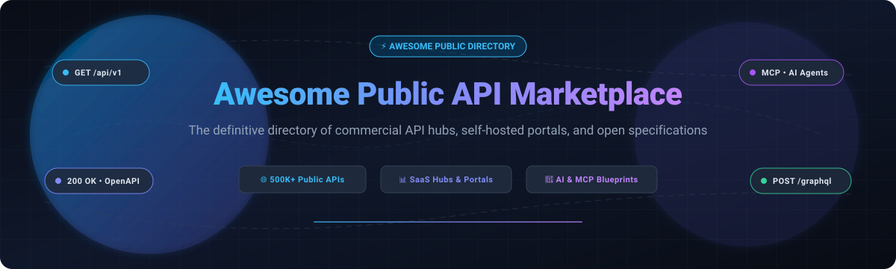

# Awesome Public API Marketplace & Directory 🚀

 
 

 

> 🌐 A curated, comprehensive list of top Public API Marketplace and Directory platforms — exploring both SaaS/Hosted commercial discovery networks and self-hosted open-source software for finding, cataloging, publishing, testing, and monetizing public APIs.  
> ⭐ **Star this repository if you find it helpful!** ⭐

---

## 📈 Sector Overview & Market Dynamics

The global **API Marketplace and Management sector** is valued at approximately **$21.3B to $25.1B** (projected to reach **$47.8B–$82.1B+** by the early 2030s at an estimated **17.6%–18.4% CAGR**). 

The industry exhibits **moderate fragmentation** moving toward selective consolidation: while foundational API infrastructure and enterprise gateway layers are concentrated among tech titans (Google Cloud Apigee, AWS, Microsoft Azure, MuleSoft/Salesforce), the **public and internal API marketplace and discovery directory layer remains highly fragmented**, characterized by a vibrant mix of specialized commercial hubs, open-source specification registries, workflow directories, and developer-led open catalogs without a single winner-take-all monopoly.

---

## 📋 Table of Contents

- [📈 Sector Overview & Market Dynamics](#-sector-overview--market-dynamics)
- [🟦 SaaS / Hosted Platforms](#-saas--hosted-platforms)
  - [Postman API Network](#postman-api-network)
  - [Zapier App Directory](#zapier-app-directory)
  - [RapidAPI Hub](#rapidapi-hub)
  - [APIs.guru](#apisguru)
- [🟩 Open-Source Software](#-open-source-software)
  - [Public APIs (public-apis)](#public-apis-public-apis)
  - [Public API Lists (public-api-lists)](#public-api-lists-public-api-lists)
  - [API Hub (hiteshchoudhary)](#api-hub-hiteshchoudhary)
  - [Public APIs (marcelscruz)](#public-apis-marcelscruz)
  - [APIs.guru OpenAPI Directory](#apisguru-openapi-directory)
  - [Fusio](#fusio)
  - [Apicurio Registry](#apicurio-registry)
  - [APIs.json Specification](#apisjson-specification)
  - [API Hub (dukex)](#api-hub-dukex)
  - [DopeForge](#dopeforge)
- [📊 Comparison at a Glance](#-comparison-at-a-glance)
- [🔍 SEO Keywords & Topic Index](#-seo-keywords--topic-index)
- [🤝 Contributing](#-contributing)
- [💖 Support](#-support)
- [📈 Star History](#-star-history)
- [📄 License](#-license)

---

## 🟦 SaaS / Hosted Platforms

Commercial, cloud-hosted Public API Marketplace and Directory platforms. Sorted by company size (valuation / estimated revenue, descending).

| Platform | Company Size (Valuation / Revenue) | Starting Paid Tier Price | Free Tier Limits | Key Highlights & Marketplace Focus |
|:---|:---|:---|:---|:---|
| **[Postman API Network](https://www.postman.com/explore)** | **$5.6B Valuation** (~$313M+ ARR) | **$9/month** (Basic/Solo billed annually at $108/yr) or **$19/user/month** (Team billed annually) | **Free Forever**: 1 user, 1,000 cloud API monitoring requests/mo, 50 Postbot AI credits/mo, 5 integrations, unlimited local mock calls & collection runs | Public API network embedded directly within the Postman API development platform; discovery layer for public workspaces & collections |
| **[Zapier App Directory](https://zapier.com/apps)** | **$5.0B Valuation** (~$340M+ ARR) | **$19.99/month** (Professional tier billed annually) or **$29.99/mo** month-to-month | **Free Forever**: 100 tasks/month, two-step Zaps only (1 trigger + 1 action), 15-minute update polling interval, basic core apps | Integration & workflow directory connecting 7,000+ app APIs with no-code trigger-action automation |
| **[RapidAPI Hub](https://rapidapi.com/hub)** | **$100M–$106M Acquisition** (Peak $1.0B Valuation; ~$24M ARR) | **$10–$29/month** (Pro plan starting tier for consumers); **25% platform fee** on publisher API sales | **Free Forever**: Up to 1,000 calls/hour & 500,000 calls/month on basic free consumer tiers; free listing for publishers | World's largest commercial multi-provider API marketplace with integrated subscription billing, key management, and analytics |
| **[APIs.guru](https://apis.guru)** | **Community-Maintained / Non-Commercial** ($0 ARR, Bootstrapped OSS) | **100% Free** ($0/month; no paid tiers or listing fees) | **Free Forever**: Unlimited search & API catalog access (OpenAPI 2.0/3.x specs for 2,500+ APIs covering 100k+ endpoints) | "Wikipedia for Web APIs"; community-driven open directory and machine-readable specification repository |

---

### Postman API Network
- 🏷️ **Type:** API discovery integrated with Postman workspaces  
- 💳 **Pricing:** Free plan available; starting paid tier at $9/month (Solo) or $19/user/month (Team, billed annually)  
- 🌟 **Details:** Postman API Network is the public directory within the Postman platform, allowing developers to discover and explore APIs published by organizations. Publishing requires a public workspace with a reference collection imported from an OpenAPI file and an overview collection. It is the natural discovery layer for teams already using Postman for API development, with no listing fee for public publishers. The network surfaces APIs within Postman's client and through organic search, making it a strong channel for API distribution.

### Zapier App Directory
- 🏷️ **Type:** Integration marketplace for no-code automation  
- 💳 **Pricing:** Free plan available (100 tasks/mo); starting paid tier at $19.99/month (Professional billed annually)  
- 🌟 **Details:** Zapier's App Directory lists integrations that connect 7,000+ apps with trigger-action workflows. It is a discovery surface for no-code automation, connecting SaaS REST APIs and webhooks into visual automations for millions of developers and enterprise business users.

### RapidAPI Hub
- 🏷️ **Type:** Commercial API marketplace with billing and key management  
- 💳 **Pricing:** Free consumer plans available; starting paid consumer tiers typically $10–$29/month; takes a flat 25% marketplace transaction fee on API provider sales  
- 🌟 **Details:** RapidAPI Hub connects developers with thousands of APIs and provides a unified billing layer, API key management, and usage analytics. Free plans on the hub are capped at 1,000 requests per hour and 500,000 per month depending on provider quotas. Payouts are processed via PayPal. It is the primary commercial reference for API monetization and multi-vendor distribution.

### APIs.guru
- 🏷️ **Type:** Community-driven machine-readable API definition directory  
- 💳 **Pricing:** 100% Free (Open Access / CC0)  
- 🌟 **Details:** APIs.guru provides a searchable directory of public API definitions in OpenAPI format, described as a "Wikipedia for Web APIs." It hosts 2,529+ API descriptions covering over 108,000 endpoints, with automated updates and conversion to OpenAPI 3.0. The key requirement for listing is a stable URL to a machine-readable definition. All data is accessible via a REST API, making it a foundational resource for code generation and tooling.

---

## 🟩 Open-Source Software

Self-hosted, community-driven Public API Marketplace and Directory tools. Sorted by GitHub stars (descending).

| Project | Stars | Stack | License | Description |
|:---|:---|:---|:---|:---|
| **[public-apis/public-apis](https://github.com/public-apis/public-apis)** |  | Markdown / Python | MIT | The definitive collective list of free public APIs for software developers, categorizing thousands of endpoints across 50+ topics. |
| **[public-api-lists/public-api-lists](https://github.com/public-api-lists/public-api-lists)** |  | TypeScript / JSON | MIT | Searchable, community-maintained list of free public APIs complete with an active, free-to-query JSON API layer. |
| **[hiteshchoudhary/apihub](https://github.com/hiteshchoudhary/apihub)** |  | JavaScript / Node.js | MIT | An open-source, full-featured public API hub with integrated mock backend endpoints built for testing and frontend development. |
| **[marcelscruz/public-apis](https://github.com/marcelscruz/public-apis)** |  | TypeScript / React / Next.js | MIT | A modern, collaborative web directory and interactive UI of public APIs with instant search, category filtering, and direct links. |
| **[APIs-guru/openapi-directory](https://github.com/APIs-guru/openapi-directory)** |  | JavaScript / YAML / JSON | CC0-1.0 | Machine-readable Wikipedia for Web APIs containing 2,500+ verified REST API definitions in OpenAPI 2.0/3.x format. |
| **[apioo/fusio](https://github.com/apioo/fusio)** |  | PHP / TypeScript | AGPL-3.0 | Self-hosted open-source API management platform and gateway with an automated developer portal, monetization tiers, and subscription handling. |
| **[Apicurio/apicurio-registry](https://github.com/Apicurio/apicurio-registry)** |  | Java / Quarkus / React | Apache-2.0 | Production-grade schema and API registry supporting OpenAPI, AsyncAPI, GraphQL, and Protobuf specifications with search and governance. |
| **[apis-json/api-json](https://github.com/apis-json/api-json)** |  | JSON / Schema | CC-BY-SA-4.0 | An open machine-readable API discovery format and specification ("sitemap for APIs") powering federated discovery engines like APIs.io. |
| **[dukex/api-hub](https://github.com/dukex/api-hub)** |  | TypeScript / Next.js / Docker | MIT | Simple OpenAPI discovery portal creating an elegant API catalog from OpenAPI specs with interactive Swagger UI and AI summaries. |
| **[DreadpiratePickles/dopeforge](https://github.com/DreadpiratePickles/dopeforge)** |  | Python / MCP | MIT | Unified registry of 6,600+ public APIs and MCP servers for AI agents (Claude, Cursor) with nightly CI live checks and executable blueprints. |

---

### Public APIs (public-apis)
  
- 🛠️ **Stack:** Markdown / GitHub | 📄 **License:** MIT  
- 🔗 **Repository:** [public-apis/public-apis](https://github.com/public-apis/public-apis)  
The **public-apis** repository is the undisputed gold standard of free public API lists, organized meticulously across dozens of categories (Animals, Blockchain, Cryptography, Development, Finance, Health, Machine Learning, News, Weather, and more). It catalogs API names, descriptions, authentication requirements (apiKey, OAuth, or None), HTTPS support, and CORS availability. Listings adhere to strict submission standards, requiring open or free tiers.

🎯 **Best for:** Developers looking for quick, authentic, and curated free public APIs for side projects, hackathons, and software prototyping.

---

### Public API Lists (public-api-lists)
  
- 🛠️ **Stack:** TypeScript / JSON | 📄 **License:** MIT  
- 🔗 **Repository:** [public-api-lists/public-api-lists](https://github.com/public-api-lists/public-api-lists)  
An actively maintained, community-driven directory indexing thousands of free public web APIs. Unlike traditional static markdown files, public-api-lists provides a live, searchable web interface and a free public JSON API endpoint, enabling programmatic retrieval and integration into custom developer portals and bots.

🎯 **Best for:** Developers needing programmatic API discovery or an actively updated, community-vetted alternative to legacy lists.

---

### API Hub (hiteshchoudhary)
  
- 🛠️ **Stack:** JavaScript / Node.js / Express | 📄 **License:** MIT  
- 🔗 **Repository:** [hiteshchoudhary/apihub](https://github.com/hiteshchoudhary/apihub)  
API Hub is a comprehensive open-source API marketplace and sandbox platform created to help frontend, mobile, and full-stack developers master API integration. It offers live endpoints for authentication, e-commerce products, social media feeds, chat messages, and quotes with instant JSON responses and full Swagger documentation.

🎯 **Best for:** Frontend, mobile, and backend engineers who need realistic public API mock backends and sandboxes for building client applications.

---

### Public APIs (marcelscruz)
  
- 🛠️ **Stack:** TypeScript / React / Next.js / Tailwind CSS | 📄 **License:** MIT  
- 🔗 **Repository:** [marcelscruz/public-apis](https://github.com/marcelscruz/public-apis)  
A high-performance, modern open-source web application showcasing public APIs with an intuitive, aesthetic user interface. Features responsive instant search, tag-based filtering by category, CORS and HTTPS indicators, and one-click access to official developer documentation.

🎯 **Best for:** Developers who prefer a fast, visual, and searchable web interface to browse and filter through public API directories.

---

### APIs.guru OpenAPI Directory
  
- 🛠️ **Stack:** JavaScript / YAML / JSON | 📄 **License:** CC0-1.0 (Public Domain)  
- 🔗 **Repository:** [APIs-guru/openapi-directory](https://github.com/APIs-guru/openapi-directory)  
The **openapi-directory** repository is the open-source machine-readable data layer behind APIs.guru, containing thousands of REST API definitions in OpenAPI 2.0 and 3.x format. Community-driven and automatically validated via CI pipelines, it is consumed by HTTP Toolkit, Apideck, Microsoft Kiota, and OpenAPI generator tools worldwide.

🎯 **Best for:** Tool builders and developers needing machine-readable OpenAPI specifications for SDK generation, automated mocking, contract testing, and federated search.

---

### Fusio
  
- 🛠️ **Stack:** PHP / TypeScript / Angular | 📄 **License:** AGPL-3.0  
- 🔗 **Repository:** [apioo/fusio](https://github.com/apioo/fusio)  
Fusio is an open-source API management system and gateway that lets you build, manage, and monetize REST APIs. It provides an automated, self-hosted developer portal and marketplace where external developers can register, obtain API keys, subscribe to rate-limited plans, purchase API credits via Stripe, and browse interactive API documentation.

🎯 **Best for:** Organizations wanting a complete self-hosted alternative to commercial API marketplaces like RapidAPI, complete with payment processing and developer onboarding.

---

### Apicurio Registry
  
- 🛠️ **Stack:** Java / Quarkus / TypeScript / React | 📄 **License:** Apache-2.0  
- 🔗 **Repository:** [Apicurio/apicurio-registry](https://github.com/Apicurio/apicurio-registry)  
Apicurio Registry is a vendor-neutral, enterprise-grade schema and API registry. It stores, catalogs, and governs OpenAPI, AsyncAPI, GraphQL, Apache Avro, Google Protobuf, and JSON Schemas with built-in version control, metadata search, artifact rules enforcement, and REST API interfaces.

🎯 **Best for:** Enterprise teams seeking a centralized internal or public API and schema catalog with strict governance, validation, and multi-format specification support.

---

### APIs.json Specification
  
- 🛠️ **Stack:** JSON / Schema | 📄 **License:** CC-BY-SA-4.0  
- 🔗 **Repository:** [apis-json/api-json](https://github.com/apis-json/api-json)  
APIs.json provides an open discovery specification that acts as a `sitemap.xml` for an organization's API ecosystem. Rather than describing single endpoints, an `apis.json` document indexes an organization's APIs, documentation portals, OpenAPI contracts, SDKs, terms of service, and pricing tiers. It is the core open standard powering the **APIs.io** federated API search engine.

🎯 **Best for:** API providers seeking a standardized, discoverable manifest format to index their entire API catalog across public search engines.

---

### API Hub (dukex)
  
- 🛠️ **Stack:** TypeScript / Next.js / Docker | 📄 **License:** MIT  
- 🔗 **Repository:** [dukex/api-hub](https://github.com/dukex/api-hub)  
API Hub is a lightweight, self-hosted OpenAPI discovery portal. By configuring a simple `specs/apis.json` file listing OpenAPI URLs, API Hub automatically builds a searchable web directory featuring team tags, interactive Swagger UI documentation, and AI-powered API summaries via Google Gemini.

🎯 **Best for:** Teams and individual developers looking for a zero-hassle, single-command Dockerized OpenAPI portal for public or team API collections.

---

### DopeForge
  
- 🛠️ **Stack:** Python / MCP | 📄 **License:** MIT  
- 🔗 **Repository:** [DreadpiratePickles/dopeforge](https://github.com/DreadpiratePickles/dopeforge)  
DopeForge is an open-source registry built specifically for AI agents (Claude Code, Cursor, Windsurf). It consolidates major GitHub catalogs into a live-verified database of 6,623 entries. Features include verified callable blueprints (base URL, endpoints, parameters), nightly CI liveness verification with dead-endpoint pruning, and an embedded Model Context Protocol (MCP) server for safe, bounded agent API calling.

🎯 **Best for:** Developers using AI coding assistants who need verified, safe, and executable public API tool calling.

---

## 📊 Comparison at a Glance

| Software / Directory | Model | Primary Stack | Machine-Readable Specs | Self-Hosted | Live Testing / Mocking | AI / MCP Ready | Best For |
|:---|:---|:---|:---:|:---:|:---:|:---:|:---|
| **Postman API Network** | Proprietary Cloud | Postman Cloud | (Postman Collection / OAS) | ❌ | ✅ (Via Postman) | ❌ | Postman workspace ecosystem discovery |
| **Zapier App Directory** | Proprietary Cloud | Python / React | ❌ (Integration specs) | ❌ | ✅ (Via Zapier Zaps) | ✅ Copilot | No-code app & API workflow automation |
| **RapidAPI Hub** | Proprietary Cloud | Node.js / React | (Proprietary / OAS import) | ❌ | ✅ (Browser console) | ❌ | Multi-provider monetization & API key billing |
| **APIs.guru** | Free Web Directory | JavaScript / Cloud | ✅ OpenAPI 2.0 / 3.x | (Data layer) | ❌ | ❌ | Public OpenAPI specification directory |
| **Public APIs (public-apis)** | Open Source (MIT) | Markdown | ❌ (Curated List) | ✅ | ❌ | ❌ | Quick discovery of free APIs for side projects |
| **Public API Lists** | Open Source (MIT) | TypeScript / JSON | ✅ Free JSON API | ✅ | ❌ | ❌ | Searchable web directory with programmatic JSON API |
| **API Hub (hiteshchoudhary)** | Open Source (MIT) | Node.js / Express | ✅ OpenAPI / Swagger | ✅ | ✅ Full Mock Endpoints | ❌ | Frontend & mobile API testing sandbox |
| **Public APIs (marcelscruz)** | Open Source (MIT) | Next.js / React | ❌ (Curated list UI) | ✅ | ❌ | ❌ | Fast, modern web UI for browsing free APIs |
| **APIs.guru Directory** | Open Source (CC0) | YAML / JSON | ✅ OpenAPI 2.0 / 3.x | ✅ (Git clone) | ❌ | ❌ | Machine-readable OAS repository for tooling |
| **Fusio** | Open Source (AGPL-3) | PHP / TypeScript | ✅ OpenAPI | ✅ | ✅ Interactive console | ❌ | Self-hosted API marketplace with Stripe billing |
| **Apicurio Registry** | Open Source (Apache-2) | Java / Quarkus | ✅ OpenAPI, GraphQL, Avro | ✅ | ❌ | ❌ | Enterprise API schema catalog and governance |
| **APIs.json** | Open Source (CC-BY-SA) | JSON Schema | ✅ APIs.json Manifest | ✅ | ❌ | ❌ | Standardized API index manifest & search engine |
| **API Hub (dukex)** | Open Source (MIT) | Next.js / Docker | ✅ OpenAPI | ✅ | ✅ Swagger UI | ✅ Gemini | Minimal self-hosted OpenAPI portal with AI summaries |
| **DopeForge** | Open Source (MIT) | Python / MCP | ✅ Blueprints | ✅ (CLI / MCP) | ✅ `forge check` | ✅ MCP Server | AI-agent API discovery and tool execution |

---

## 🔍 SEO Keywords & Topic Index

`public api marketplace`, `api directory`, `open source api directory`, `free public apis`, `api hub`, `openapi directory`, `api catalog`, `rest api discovery`, `self-hosted api portal`, `api monetization`, `mcp public apis`, `postman alternative`, `rapidapi alternative`, `apis.guru`, `apis.json`.

---

## 🤝 Contributing

Contributions are welcome! If you know of an open-source Public API Marketplace, Directory, or Catalog tool that should be listed here:

1. 🍴 Fork this repository.
2. ✍️ Add your project following the table and detailed section formats (Project name, GitHub star badge, Stack, License, description, and key features).
3. 🧪 Ensure the project is actively maintained with valid open-source licensing.
4. 🚀 Submit a Pull Request with a brief explanation of why the tool stands out.

---

## 💖 Support

Thank you for exploring the **Awesome Public API Marketplace & Directory**! If this repository has helped you discover useful APIs, tools, or architectures, please consider supporting the project:

- ⭐ **Star** this repository to show your appreciation and help other developers find it.
- 🍴 **Fork** and contribute new tools or directories to keep the list fresh.
- 📢 **Share** this collection on social media, developer communities, and with your team.
- ☕ **Buy me a coffee / Sponsor**: If you'd like to support ongoing maintenance and new curated resources, you can sponsor the project via the [GitHub Sponsors Dashboard](https://github.com/sponsors/ishandutta2007).

---

##  Star History

---

## 📄 License

This compilation is released under the [CC0 1.0 Universal (Public Domain)](https://creativecommons.org/publicdomain/zero/1.0/) license. Individual projects and platforms retain their respective licenses and trademarks.

---

⭐ <b>Found this directory helpful? Give it a star on GitHub!</b> ⭐

